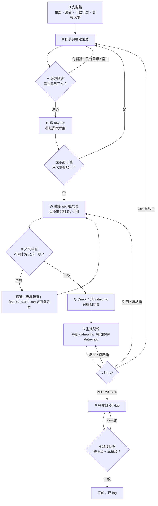

# Loop / Graph 設計、執行紀錄與反思

## 1. 流程圖（graph）

文字版：

    先討論 → 搜尋擷取 → ⟲擷取驗證 → 寫 raw → ⟲(湊滿 5 篇)
    → 編譯 wiki → ⟲交叉檢查公式 → Query → 生成簡報 → ⟲lint → 發佈 → ⟲雜湊比對 → 完成

## 2. 哪些步驟會重複執行？

| 迴圈 | 重複的步驟 | 什麼時候停 |
|---|---|---|
| 擷取迴圈 | 搜尋 → 擷取 → 驗證 | 拿到正文，而且累積滿 5 篇、涵蓋大綱每一節 |
| 編譯迴圈 | 寫概念頁 → 交叉檢查 | 同一個概念在不同來源的公式、符號一致（或已記錄差異） |
| 簡報迴圈 | 生成 → lint | lint 輸出 ALL CHECKS PASSED |
| 發佈迴圈 | 上傳 → 雜湊比對 | 每個線上檔案的 SHA-256 和本機一致 |

## 3. 哪些地方需要檢查或重新生成？為什麼這樣設計？

- **擷取驗證（V）**：網頁回 200 不代表有內容。這次就遇到付費牆和只抓到目錄的頁面。這裡不擋，錯誤會一路流進 wiki 和簡報。
- **交叉檢查（X）**：STA 公式的正負號在不同教材寫法不同（skew 的方向）。在編譯時就統一，簡報才不會前後矛盾。
- **lint（L）**：把「每條重點都有引用」、「每張投影片都對得回 wiki」、「每個數字都算對」變成程式檢查，不靠眼睛看。lint 失敗時依錯誤類型**回到不同節點**：wiki 缺內容就回去 ingest，不在簡報裡硬補。
- **雜湊比對（H）**：檔案是透過網頁編輯器上傳的，可能掉字。

設計原則：**簡報只能從 wiki 來，wiki 只能從 raw 來**。所以檢查要越早越好，越晚發現的錯，要回頭重做的範圍越大。

## 4. 一次實際執行的紀錄（2026-11-14）

### 4.1 擷取（F → V）

| 嘗試的來源 | 驗證結果 | 處理 |
|---|---|---|
| halbleiter.org STA Setup & Hold | ✗ 只有免費預覽，slack 公式、修法都在付費牆後 | 捨棄，不寫進 raw |
| AMD UG906 Timing-Path-Summary 頁 | ✗ 直接抓取只拿到導覽選單和目錄 | 改抓 Setup/Recovery-Relationship 等頁面，raw 標「部分」 |
| UBC ELEX 2117 lec9 | ✓ 完整 | → S1 |
| WPI ECE 574 timing | ✓ 完整 | → S2 |
| AMD UG906（其他頁） | ✓ | → S3 |
| AMD UG903 | ✓ | → S4 |
| AMD UG949 | ✓ | → S5 |

7 次嘗試，2 次在驗證節點被擋下，最後 ingest 5 篇。

### 4.2 交叉檢查（X）

- 發現 S2（把 skew 當成永遠扣掉的不確定量）和 S5（setup 式子「+ skew」，可正可負）寫法不同。
- 處理：CLAUDE.md 第 5 節定下全站符號約定（skew = 目的端 − 來源端）；slack.md 與 clock-skew-uncertainty.md 的「容易搞混」記錄差異。
- slack.md 例 2、例 3 都用「完整式」和「簡化式」各算一次，兩邊結果一致（2.45 ns、−0.05 ns）。

### 4.3 lint 紀錄（L）

| 次數 | 時機 | 結果 |
|---|---|---|
| 1 | wiki 7 頁寫完後 | 7 頁引用全部通過；2 個錯誤：docs/workflow.md 不存在（index 連結失效）、slides 不存在 → 照流程繼續做 |
| 2 | 簡報寫完後 | 15 張投影片、17 個算式全部正確；剩 1 個錯誤：workflow.md 不存在 |
| 測試 | 故意把 hold slack 的 −0.05 改成 0.05 | lint 抓到「算式 2.2-2.25 = -0.05，但簡報寫 0.05」✔，證明檢查有效 |
| 3 | 本文件與 log 寫完後 | ALL CHECKS PASSED |

### 4.4 發佈（P → H）

所有檔案上傳後，從 GitHub clone 回來，逐檔比對 SHA-256 與本機版本，並重跑 lint。

## 5. 反思

**哪一個節點最常出錯？**
「搜尋與擷取」（F）。7 次擷取有 2 次「看起來成功、其實沒內容」：一次是付費牆，一次只拿到目錄。這種錯最危險，因為它不會報錯。如果直接進到編譯，AI 很容易用自己的記憶把缺的公式「補」上，wiki 就不再能追溯到來源。

**發現問題後，把檢查往前移到了哪一步？**
原本只打算在最後跑一次 lint。後來把檢查往前移了兩處：
1. 移到**擷取之後、寫 raw 之前**（V 節點）：每篇 raw 都要填「擷取狀態：完整 / 部分 / 失敗」，失敗就換來源，不准用記憶補。
2. 移到**編譯 wiki 時**（X 節點）：符號約定在寫概念頁之前就定好，每個例子用兩種公式各算一次，不等到簡報才發現矛盾。

**有沒有因此修改 workflow / graph？為什麼？**
有，改了三處：
- 加入 V 節點與「擷取迴圈」。原因：錯誤越晚發現，要重做的範圍越大（raw → wiki → 簡報全部要改）。
- lint 失敗時改成**依錯誤類型回到不同節點**，而不是一律回到「生成簡報」。原因：wiki 缺內容時，在簡報裡補等於繞過來源，會違反「簡報只能從 wiki 來」。
- 簡報數字改用 data-calc 標註，由 lint 重算。原因：教學簡報的計算題錯一個正負號，學生就會學錯，這種錯用眼睛很難看出來（測試時故意改一個號，lint 確實抓到）。
